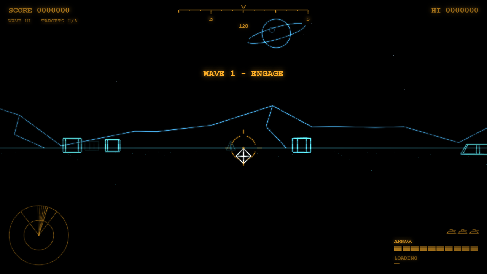
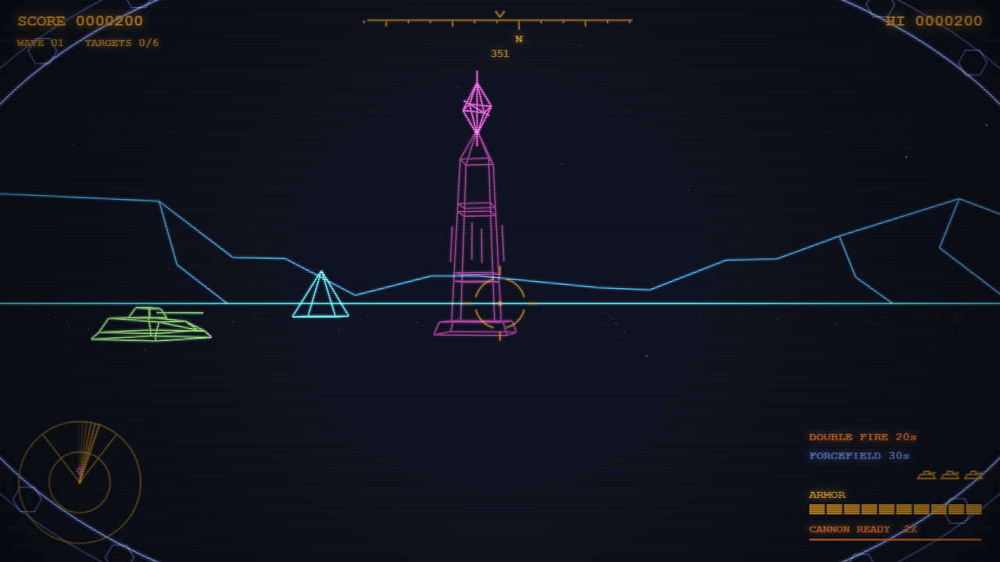
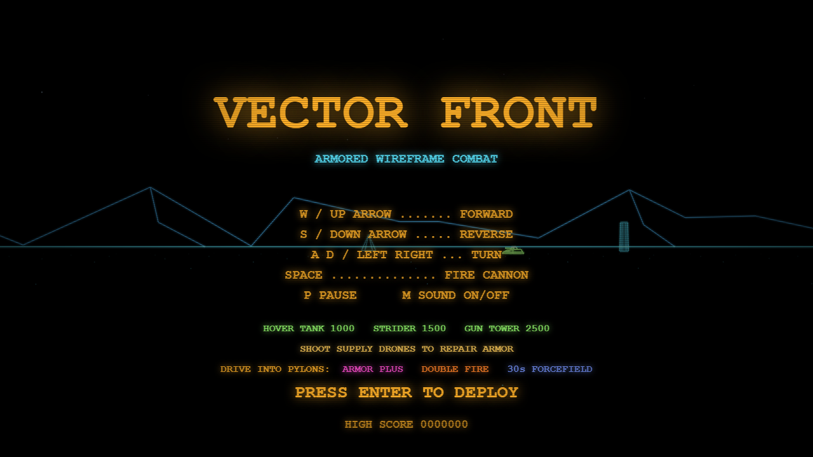

# Battle Zone Recreation

An original first-person wireframe tank game that runs in the browser. One HTML file, no downloads, no libraries, no image or sound files.

**Play it:** https://powellga.github.io/vector-front/BattleZone.html

## How to play

Open `BattleZone.html` in any modern browser and press Enter.

| Key | Action |
| --- | --- |
| W / Up arrow | Forward |
| S / Down arrow | Reverse |
| A, D / Left, Right | Turn |
| Space | Fire cannon |
| P | Pause |
| M | Sound on/off |
| Enter | Start |

## Enemies

- **Hover tank** - 1000 points
- **Strider** - a ramming drone, 1500 points, from wave 2
- **Gun tower** - takes two hits, 2500 points, from wave 3
- **Supply drone** - shoot it to repair 50 armor

Each wave needs 4 + 2 x wave kills. You get a bonus tank every 30,000 points. The high score is saved in your browser.

## Power pylons

Nine glowing obelisks stand around the map, three of each kind. Drive into one to use it. It then goes dark and recharges for 45 seconds. Each one shows on the radar as a small diamond in its color.

- **Armor Plus (magenta)** - fills your armor to 150, which is 50 more than the normal maximum
- **Double Fire (orange)** - your cannon reloads twice as fast for 20 seconds
- **Forcefield (blue)** - 30 seconds of full protection. Enemy shells bounce off, and striders that ram you are destroyed. It beeps and flickers for the last 5 seconds

## Features

- Wireframe world on an 800 x 800 map that wraps at the edges
- Compass strip, radar sweep, target-lock reticle, armor bar and off-screen enemy arrows
- All sound generated live with the Web Audio API
